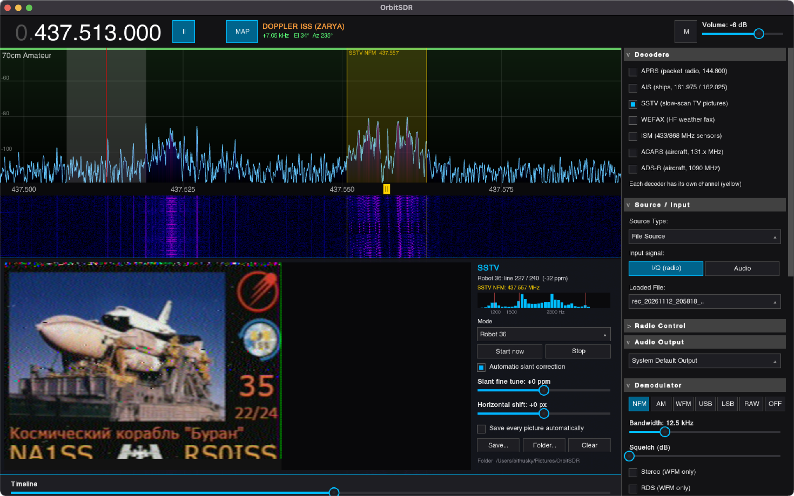

# OrbitSDR

**A fast, lightweight SDR receiver with built-in decoders. Build with Apple Silicon in mind, also runs on Windows and Linux.**

[](https://github.com/krzysztofchojka/OrbitSDR/actions)




OrbitSDR is a C++17 / SFML receiver that stays small and responsive while decoding several digital modes at once. Plug in an SDRplay or an RTL-SDR, enable a decoder, and it tunes its own channel to the right frequency. You can keep listening to something else in the meantime.

- **Built for Apple Silicon (M1 and newer) and SDRplay.** That is the main development and test platform. No Homebrew or drivers needed for RTL-SDR, everything is bundled in the `.app`. For SDRPlay you have to install official [SDRPlay Api](https://sdrplay.com/hardware-api/).
- **Thirteen decoders built in:** APRS, AIS, ACARS, VDL2, ADS-B, ISM sensors (rtl_433), RDS, SSTV, WEFAX, FT8 / FT4 / WSPR, CW (Morse), NAVTEX and DSC.
- **Several receivers at once, in tabs.** "+ Add receiver" below the top bar opens another tab with its own source (a second RTL-SDR, an SDRplay, rtl_tcp, a file ...), waterfall, settings and decoders, e.g. APRS on 2 m in one tab and ADS-B on 1090 MHz in another. The tabs not shown keep receiving and decoding (no waterfall is drawn for them). The speaker icon on each tab switches that receiver's sound on or off, so e.g. FM broadcast from one radio can play in the background while you watch another; the sounds of several tabs are mixed. Each tab can also play on its own output device (**Audio Output** in the sidebar), e.g. RX1 on the speakers and RX2 on headphones or a virtual cable (VB-Cable, BlackHole) into another program. The tabs and their sources are restored at the next start.
- **Several decoders at once, each on its own channel.** Decode AIS and APRS, watch the 433 MHz sensors and listen to FM radio at the same time, all within one bandwidth. Every running decoder has a tab above the decoder panel; the decoders run in their own thread, so the audio never waits for them.
- **Tested on real signals:** ships in harbours, weather stations and car tyre sensors in the city, APRS, SSTV, HF radiofax and RDS.

## Download

Get the latest build from the **[Releases page](https://github.com/krzysztofchojka/OrbitSDR/releases/latest)**.

| Platform | File | Notes |
|---|---|---|
| **macOS 15+ (Apple Silicon)** | `OrbitSDR_vX.Y.Z_macOS_arm64.zip` | Primary platform. See [first launch on macOS](#first-launch-on-macos). |
| **Windows 10/11 x64** | `OrbitSDR_vX.Y.Z_windows_x64_setup.exe` or `_portable.zip` | Installer or portable zip. |
| **Linux x64** | `OrbitSDR_vX.Y.Z_linux_amd64.deb` or `.tar.gz` | Ubuntu 24.04 and newer (and other distributions with glibc 2.39+). |
| **Linux ARM64** | `OrbitSDR_vX.Y.Z_linux_arm64.deb` or `.tar.gz` | Raspberry Pi 4/5 (64-bit Raspberry Pi OS Bookworm), other ARM boards. |

Development builds of every commit are in the [Actions](https://github.com/krzysztofchojka/OrbitSDR/actions) tab (you need a GitHub account to download them).

### First launch on macOS

The app is not notarized by Apple, so macOS blocks it the first time. You only have to allow it once:

1. Unzip `OrbitSDR_vX.Y.Z_macOS_arm64.zip`, move `OrbitSDR.app` to **Applications** and open it.
2. macOS shows *"OrbitSDR" Not Opened*. Click **Done**.
3. Open **System Settings → Privacy & Security** and scroll down to the **Security** section.
4. Next to *"OrbitSDR" was blocked to protect your Mac*, click **Open Anyway** and confirm with your password or Touch ID.
5. Open OrbitSDR again and click **Open Anyway** in the dialog.

From then on OrbitSDR opens normally. Alternatively, you can remove the quarantine flag in Terminal:

```sh
xattr -dr com.apple.quarantine /Applications/OrbitSDR.app
```

## Supported sources

| Source | Details |
|---|---|
| **SDRplay** (RSP1A, RSP2, RSPdx, RSPduo...) | Antenna port selection, notch filters, Bias-T. Requires the [SDRplay API service](https://www.sdrplay.com/downloads/). |
| **RTL-SDR** | Standard and Direct Sampling (HF) modes, Bias-T, frequency correction (ppm). |
| **rtl_tcp** | Network RTL-SDR, e.g. a Raspberry Pi next to the antenna. |
| **Sound card** | Line-in / microphone as a baseband (I/Q) or audio source, e.g. the audio output of a scanner or transceiver. |
| **WAV files** | I/Q recordings (stereo) or demodulated audio (mono), 8/16/24-bit integer or 32-bit float, with a seekable timeline. |

## Decoders

| Decoder | Typical frequency | What you get |
|---|---|---|
| **Digital voice** (DMR, dPMR, D-STAR, YSF, NXDN) | e.g. PMR446 (446.0–446.2 MHz), ham repeaters, ports, events, business radio | Finds the system by itself. DMR: colour code, repeater or direct mode, both time slots with source ID → talkgroup / private call, talker alias, GPS, emergency, the manufacturer feature set and the system type (Tier II, Capacity Plus, Connect Plus, Tier III). dPMR: colour code, IDs. D-STAR: callsigns, repeaters, text, locator. YSF: callsigns, uplink / downlink. NXDN: RAN, IDs. Several channels at once (**+ Channel at tuner** pins the tuner's frequency), a card per channel and a list of calls; the speech goes to the speaker (one channel at a time or all mixed). Encrypted calls are marked with the algorithm and key id and kept silent: nothing is ever decrypted. Signals no decoder understands are described (TETRA, analog FM, FSK of an unknown system). Also decodes a scanner's discriminator audio (Input: Audio). |
| **AIS** | 161.975 / 162.025 MHz | Ships: name, call sign, type, position, speed, course. Both channels decoded at once. |
| **ISM** (rtl_433) | 433.92 / 868 / 315 / 915 MHz | About 300 device types: weather stations, thermometers, tyre pressure sensors (TPMS), door sensors, remotes, utility meters. |
| **ACARS** | 129–137 MHz | Aircraft datalink: registration, flight, label, message text. All ACARS channels in the bandwidth are decoded at once. |
| **ADS-B** | 1090 MHz | Aircraft: callsign, altitude, speed, track, vertical rate, squawk and position (Mode S / extended squitter, like dump1090). Needs 2.4 or 2.0 MS/s; **Tune to 1090 MHz** in the panel sets the radio. Aircraft appear on the satellite map. |
| **APRS** | 144.800 MHz (EU) / 144.390 MHz (US) | AX.25 packets, messages and GPS positions. The 20 kHz channel still decodes when the radio is a few kHz off; for a bigger error set the frequency correction (ppm) in Radio Control. |
| **RDS** | FM broadcast | Station name, RadioText, PI, programme type, TP/TA, clock time. Also used to tune the WFM gain automatically. |
| **SSTV** | 145.800 MHz (ISS), HF | Robot 36/72, Martin M1/M2, Scottie S1/S2/DX, PD50–PD290. VIS auto-detection, slant correction, PNG export. |
| **WEFAX** | HF radiofax stations | Automatic start/stop, phasing, LPM/IOC selection, slant correction, PNG export. |
| **VDL2** | 136.650–136.975 MHz | VDL Mode 2 aircraft datalink (most European ACARS traffic today): ACARS messages, aircraft position and destination from XID frames, ground station positions. All VDL2 channels in the bandwidth are decoded at once (2 MS/s around 136.8 MHz covers them all). |
| **FT8 / FT4 / WSPR** | HF and 6 m / 2 m dial frequencies (e.g. 7.074, 14.074 MHz) | Every known dial frequency in the bandwidth is decoded at once (FT8, FT4 and WSPR side by side), plus a channel on the tuner (USB: put the tuner just below the signals, its mode is chosen in the panel). Recordings without a start time in the file name are fine too: the slot timing is found automatically (times marked "~"). Message, SNR, time offset; stations with a locator appear on the map. Uses UTC time slots, so the computer clock must be right. Also decodes the USB audio of a transceiver (Input: Audio). |
| **CW** | anywhere | Morse decoder: finds and follows the tone inside its channel, learns the speed (5–50 WPM). |
| **NAVTEX** | 518 / 490 kHz, 4209.5 kHz | Maritime safety broadcasts (SITOR-B): navigational and weather warnings, forecasts, search and rescue. Station, subject and number of each message; the text appears while it is being received. All NAVTEX frequencies in the bandwidth are decoded at once (USB/CW to listen). |
| **DSC** | 156.525 MHz (VHF ch 70), 2187.5 / 4207.5 / 6312 / 8414.5 / 12577 / 16804.5 kHz | Digital Selective Calling (GMDSS): distress, urgency, safety and routine calls between ships and coast stations. MMSI of caller and called station, nature of distress, position, working channel. Distress calls are shown in red; positions go on the map (with the ship's AIS track, same MMSI). Also decodes a scanner's FM audio (Input: Audio). |

The digital voice modes are also in the **Demodulator** (second row: DIGITAL finds the system, or DMR / dPMR / D-STAR / YSF / NXDN): they just play the speech like NFM, with a short status below the buttons and a choice of the DMR time slot. Bookmarks keep the mode, so the **scanner** can scan NFM and DMR channels mixed; on a digital voice bookmark it stops only for speech, not for a repeater's idle frames.

Decoded messages are logged in the settings folder (`digitalvoice.log`, `ism.log`, `acars.log`, `vdl2.log`, `wsjt.log`, `cw.log`, `navtex.log`, `dsc.log`, `aprs.log`). **Export** saves the messages of the current session to a file. Click a row in any decoder table to see all of its fields.

## Features

- **Demodulation:** AM, NFM, USB, LSB, CW (700 Hz tone, narrow filter down to 50 Hz), WFM stereo, RAW.
- **Bookmarks and scanner:** save the tuned frequency with its mode and bandwidth (Bookmarks / Scanner in the sidebar, stored in `bookmarks.json`), grouped in banks (e.g. "2 m repeaters", "Airband"); the list and the scanner show the chosen bank. Click a bookmark to tune to it. **Scan** steps through the ticked bookmarks, stops on a signal above the SNR threshold, stays while it is there and resumes after the hang time; the speaker is muted while it searches. Tuning by hand stops the scan.
- **Waterfall and spectrum:** drag to tune, zoom, axis panning, frequency snapping, band plan overlay.
- **Decoder channels:** each decoder has its own channel(s), shown as coloured bands on the spectrum (the colour of its tab) with a handle on the tuning bar. When you enable a decoder its channels jump to the known frequencies inside the received band. Otherwise they follow the tuner.
  - Drag a handle to move a channel. It snaps to known frequencies and to the tuner.
  - Drop it on the tuner to make it follow the tuner.
  - Click it to listen to that channel.
  - An arrow at the edge of the tuning bar points to a channel that is outside the view.
- **I/Q or audio input:** for files and the sound card you choose whether the input is I/Q or demodulated audio. In audio mode, APRS, SSTV, WEFAX and ACARS decode the audio directly. ISM, AIS and ADS-B need I/Q from an SDR.
- **Recording:** demodulated audio or raw baseband I/Q to WAV.
- **Low sample rates:** software decimation, so even narrow bandwidths stay smooth.

- **Satellite map and tracking (MAP button):** a second window with a world map, in the spirit of Orbitron:
  - live positions, footprints (coverage above your minimum elevation), ground tracks, day/night shading and the sun,
  - satellite groups from CelesTrak (amateur, weather, stations, CubeSats, SatNOGS...), search by name or NORAD number, favourites, and your own TLEs (paste from the clipboard or import a file),
  - details of the selected satellite: azimuth / elevation, range, range rate, sunlight / eclipse, polar plot of the pass, the next passes (click one to jump the map to it),
  - transmitters from the SatNOGS DB with **Track freq** (tune once) or **Track Doppler** (follow the pass). You choose the receiver (tab) and what is tuned: its tuner or a decoder's channel (a chosen decoder, or automatically the one the transmitter needs). Tracking keeps working while another tab is shown, so SSTV from the ISS decodes while you listen to something else. Manual fine tuning during tracking is kept as an offset,
  - TLEs are cached for offline use: refreshed after 24 hours, marked stale after 4 days.

<details>
<summary><b>ISM decoder details</b></summary>

- Decoding width of 250 kHz or 1 MHz.
- **Decoders: + extra** enables about 50 more rtl_433 decoders that are off by default. They only receive packets that no default decoder recognised. Their results are marked "(?)" because they can also match other devices.
- **Unknown: shown** lists every unrecognised packet with its guessed modulation, timing and bits.
- On RTL-SDR a slow "burst" AGC is used, so the gain never changes in the middle of a packet.

</details>

## Status and roadmap

OrbitSDR is under active development. macOS on Apple Silicon and Windows with SDRplay is the most tested setup. Linux and RTL-SDR builds are produced for every commit and work, but have had less testing.

- AIS, ISM, APRS, RDS, SSTV and WEFAX have been tested on real off-air signals.
- **ACARS has only been tested with recordings so far.** If you live near an airport, please try it and [report the result](https://github.com/krzysztofchojka/OrbitSDR/issues).
- **VDL2, FT8 / FT4 / WSPR, CW, NAVTEX and DSC are new and have been tested with generated signals only.** Reports with real signals (and recordings that don't decode) are very welcome.
- **Digital voice has been tested with a DMR recording (discriminator audio) and generated signals.** dPMR, D-STAR, YSF and NXDN use the same proven library (DSDcc, as in SDRangel) but have not been tried with OrbitSDR yet: recordings are welcome.
- More digital decoders are planned.

Bug reports, recordings of signals that don't decode, and feature requests are very welcome in [Issues](https://github.com/krzysztofchojka/OrbitSDR/issues). If OrbitSDR is useful to you, a ⭐ helps other people find it.

## Satellite data and the OrbitSDR API

The map downloads TLEs, transmitter lists and the world map through the OrbitSDR API, a small caching proxy ([`server/orbitsdr-api.php`](server/orbitsdr-api.php)), so [CelesTrak](https://celestrak.org) and the [SatNOGS DB](https://db.satnogs.org) see one polite client instead of every installation. When the proxy does not answer, OrbitSDR asks CelesTrak and SatNOGS directly. Everything is also cached in the settings folder (`tle/`).

The addresses are in [`orbitsdr.ini`](assets/orbitsdr.ini), shipped next to the program. To use your own proxy, put a copy in the settings folder (`%APPDATA%\OrbitSDR` on Windows, `~/.config/orbitsdr` on macOS / Linux). That copy wins:

```ini
api_url = https://example.com/orbitsdr/orbitsdr-api.php
api_key = ORBITSDR_APP
map_url =
```

The key `ORBITSDR_APP` is public on purpose (OrbitSDR is open source). It only marks requests as coming from OrbitSDR, and the proxy's cache and rate limit deal with abuse. See [`server/README.md`](server/README.md) to run your own proxy.

## Building from source

### macOS

```sh
brew install sfml librtlsdr
chmod +x build.sh
./build.sh            # SDRplay support included (add --disable-sdrplay to leave it out)
```

### Linux (Ubuntu / Debian)

```sh
sudo apt update
sudo apt install build-essential libsfml-dev librtlsdr-dev zenity
chmod +x build.sh
./build.sh
```

You need SFML **3.0**. If your distribution ships SFML 2.x, build SFML 3 from source.

### Windows

Install [MSYS2](https://www.msys2.org/), open the **UCRT64** shell in the project folder and run:

```sh
./scripts/build_mingw_local.sh
```

The script installs the compiler and librtlsdr with `pacman`, downloads SFML 3.0 for MinGW and builds `orbitsdr.exe` with all DLLs next to it.

### SDRplay API

OrbitSDR does not link against the SDRplay API. It loads the API at run time: the version installed on your system first, and if that fails, the bundled copy (API 3.15). Without the API the program still starts, and only the SDRplay source is unavailable. Get the API from the [SDRplay downloads page](https://www.sdrplay.com/downloads/).

### rtl_433 (ISM decoder)

The rtl_433 sources are not stored in this repository. The build scripts call `scripts/rtl433.sh`, which downloads a pinned rtl_433 commit once into `.cache/` and compiles it into a static library. Later builds reuse it. You only need `curl` (or `wget`/`git`), `tar` and a C compiler.

- To update rtl_433, change `RTL433_REF` in `scripts/rtl433.sh`.
- Without network access and with an empty cache, OrbitSDR still builds, just without the ISM decoder.
- `RTL433_DISABLE=1` skips rtl_433 on purpose. `ORBITSDR_CACHE=/path` moves the cache.

### ft8_lib (FT8 / FT4 decoder)

[ft8_lib](https://github.com/kgoba/ft8_lib) (MIT) is kept in `deps/ft8_lib`. The build scripts call `scripts/ft8lib.sh`, which compiles it once with the C compiler into `.cache/`. If that fails, OrbitSDR is built without FT8 / FT4 (WSPR still works).

### DSDcc and mbelib (digital voice)

[DSDcc](https://github.com/f4exb/dsdcc) (GPL v3, with OrbitSDR's additions, see `deps/dsdcc/README.md`) and [mbelib](https://github.com/szechyjs/mbelib) (ISC) are kept in `deps/`. The build scripts call `scripts/dsdcc.sh`, which compiles them once into `.cache/`. The voice codecs (AMBE / IMBE) may be covered by patents in some countries: `./build.sh --no-vocoder` (or `ORBITSDR_NO_VOCODER=1` for any build script) leaves mbelib out, the calls are then shown without speech. `--disable-digital` (`ORBITSDR_NO_DIGITAL=1`) leaves out digital voice entirely.

## License and credits

OrbitSDR is licensed under the [GNU GPL v3](LICENSE).

It uses [SFML](https://www.sfml-dev.org/), [miniaudio](https://miniaud.io/), [librtlsdr](https://osmocom.org/projects/rtl-sdr), [rtl_433](https://github.com/merbanan/rtl_433) (GPL-2.0-or-later), [ft8_lib](https://github.com/kgoba/ft8_lib) (MIT), [DSDcc](https://github.com/f4exb/dsdcc) (Edouard Griffiths F4EXB; GPL v3), [mbelib](https://github.com/szechyjs/mbelib) (ISC) and the [SDRplay API](https://www.sdrplay.com/).

The WSPR decoder is a C++ port of wsprd from [WSJT-X](https://wsjt.sourceforge.io/) (K1JT, K9AN; GPL v3), the VDL2 decoder follows [dumpvdl2](https://github.com/szpajder/dumpvdl2) (Tomasz Lemiech; GPL v3) with the Reed-Solomon decoder of Phil Karn's libfec (LGPL). The NAVTEX and DSC decoders follow the ones in [SDRangel](https://github.com/f4exb/sdrangel) (Jon Beniston; GPL v3), the CCIR 476 tables are taken from there.
