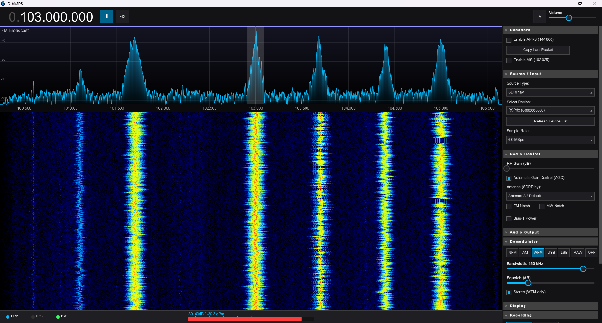

# OrbitSDR

A lightweight, multiplatform SDR software built with C++17 and SFML. 


Please note that this project is in a very early stage of development. It is currently tested primarily on **macOS** (Apple Silicon) but supports Linux and Windows. 

**Development builds** (artifacts) are available in the [GitHub Actions](https://github.com/krzysztofchojka/OrbitSDR/actions) tab (requires GitHub account).



## Features

- **Hardware Support:**
  - **SDRPlay (build with API 3.15):** Support includes **Notch Filters**, **Antenna Port selection**, and **Bias-T**.
  - **RTL-SDR:** Supports standard operation and **Direct Sampling** mode.
  - Sound card as baseband source.
- **Baseband Player:** Play raw IQ `.wav` files (stereo) or demodulated audio (mono) with a seekable timeline slider to analyze recordings (for now only 16-bit PCM is supported).
- **Integrated APRS:** Built-in AX.25 packet decoder with a live dashboard for messages and GPS telemetry (more digital modes planned).
- **AIS:** Ship tracking on 161.975 / 162.025 MHz (both channels at once when they fit into the bandwidth) with a live table of vessels: name, call sign, type, position, speed and course.
- **RDS:** Decodes Radio Data System on WFM broadcasts: station name (PS), RadioText, PI code, programme type (PTY), TP/TA flags and clock time.
- **SSTV:** Slow-scan TV picture decoder with VIS auto-detection (Robot 36/72, Martin M1/M2, Scottie S1/S2/DX, PD50-PD290), automatic slant correction and PNG saving.
- **WEFAX:** HF radiofax decoder with automatic start/stop (APT tones), phasing, selectable LPM/IOC, slant correction and PNG saving.
- **ISM (433 / 868 / 315 / 915 MHz):** Decodes weather stations, thermometers, tyre pressure sensors (TPMS), door/window sensors, remotes and utility meters using the ~300 device decoders of [rtl_433](https://github.com/merbanan/rtl_433). Tune to e.g. 433.92 MHz and enable *ISM* in the Decoders section: a live table lists the devices heard (click a row for a window with all fields). 250 kHz or 1 MHz decoding width. *Decoders: + extra* adds the ~50 decoders rtl_433 disables by default (they only get packages no default decoder recognised, and are marked "(?)" because they also match other devices); *Unknown: shown* lists every other package with its guessed modulation, timing and bits. A slow "burst" AGC on RTL-SDR so the gain never changes in the middle of a packet.
- **ACARS:** Aircraft datalink messages (VHF AM, 2400 bit/s MSK). Every known ACARS channel inside the received bandwidth is decoded at the same time (e.g. tune 131.650 MHz with 2 MSps for 131.525 / 131.725 / 131.825 / 131.850 MHz). Table of messages with aircraft registration, flight, label and text; click a row for the full message.
- **Decoder logs:** ISM and ACARS messages are appended to `ism.log` / `acars.log` in the settings folder (like `aprs.log`). *Open log* opens the file, *Export* saves the messages of the current session to a file of your choice.
- **Input signal switch (I/Q / Audio):** in *Source / Input*. It is set automatically when a source is opened (sound card and mono WAV = Audio, stereo WAV = I/Q) and can be changed by hand; it is shown only for files and the sound card, radios always deliver I/Q, e.g. for a stereo audio recording. With *Audio* the demodulator runs in RAW mode and APRS, SSTV, WEFAX and ACARS decode the audio directly (e.g. from the audio output of a scanner / transceiver); ISM and AIS need I/Q from an SDR.
- **Decoder channels (one model for all decoders):** every decoder listens to its own channel(s) and demodulates them itself, so the tuner and the demodulator mode stay free for listening. The channels are the yellow bands on the spectrum / waterfall with a handle on the tuning bar. When a decoder is switched on its channels go to the well known frequencies inside the band (APRS 144.800, AIS 161.975 / 162.025, ACARS 131.x, ISM 433.92, SSTV 145.800 / HF, WEFAX stations...), otherwise the channel follows the tuner. Drag a handle to move a channel (it snaps to the known frequencies and to the tuner), drop it on the tuner to make it follow the tuner, click it to listen (the tuner jumps there in the right mode). A channel outside the view is an arrow at the edge of the tuning bar.
- **Recording:** Record both demodulated Audio or raw Baseband IQ data.
- **Smooth UX:** Responsive waterfall with drag-to-tune, axis panning, and frequency snapping.
- **Demodulation:** Supports AM, NFM, LSB/USB, and WFM Stereo.

### To-Do / Known Limitations

- **Decoders:** Currently APRS (AX.25), AIS, RDS, SSTV, WEFAX, ISM (rtl_433) and ACARS are supported, more digital decoders will be added in future updates.
- Add support for 32-bit Float baseband recordings.

---

### SDRPlay Requirements
To use SDRPlay devices, you must have the **SDRPlay API (Service)** installed on your system.
* **Tested Version:** This software is developed and tested with **API 3.15**.
* **Compatibility:** Other versions (e.g., 3.07 or newer 3.x releases) might work, but stability is not guaranteed.
* **Download:** You can get the API drivers from the [SDRPlay Downloads page](https://www.sdrplay.com/downloads/).


### rtl_433 (ISM decoder) at build time
The rtl_433 sources are not stored in this repository. The build scripts (`build.sh`, `build_mingw.sh`, `build_mingw_local.sh`) call `scripts/rtl433.sh`, which downloads a pinned rtl_433 commit **once** into `.cache/` (ignored by git), compiles it into a static library once per compiler and reuses it on every later build. Only `curl` (or `wget`/`git`), `tar` and a C compiler are needed.
* To update rtl_433 change `RTL433_REF` in `scripts/rtl433.sh`.
* Without network access (and an empty cache) OrbitSDR is still built, just without the ISM decoder. `RTL433_DISABLE=1` skips it on purpose; `ORBITSDR_CACHE=/path` moves the cache.
* rtl_433 is GPL-2.0-or-later, which is compatible with OrbitSDR's GPL-3.0.

## Building on macOS
### 1. Install Dependencies (Homebrew):
```sh
brew install sfml
brew install librtlsdr
```
### 2. Build
```sh
chmod +x build.sh
./build.sh
```
*The script will ask if you want to link SDRPlay libraries.*

## Building on Linux
### 1. Install Dependencies (Ubuntu/Debian):
```sh
sudo apt update
# Note: Ensure you install SFML 3.0. If your repo has 2.x, build SFML from source.
sudo apt install build-essential libsfml-dev librtlsdr-dev zenity
```
### 2. Build
```sh
chmod +x build.sh
./build.sh
```
*The script will ask if you want to link SDRPlay libraries.*
<br>
### Windows Users
---
For Windows, I recommend downloading the pre-compiled artifact from the Releases or Actions tab.
Manual Compilation instructions for building from source on Windows are not yet documented. The automated builds use standard MSVC environment.